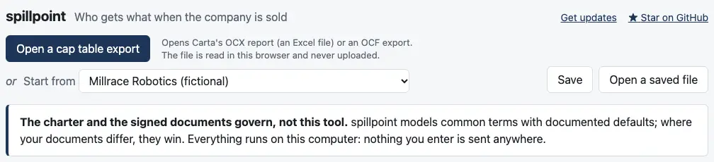
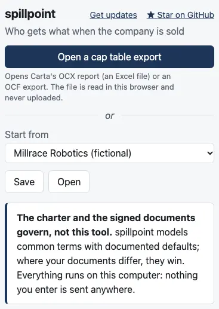
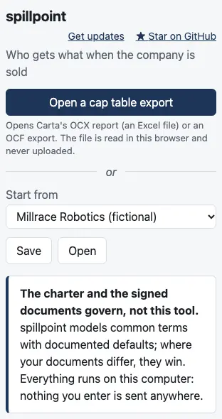
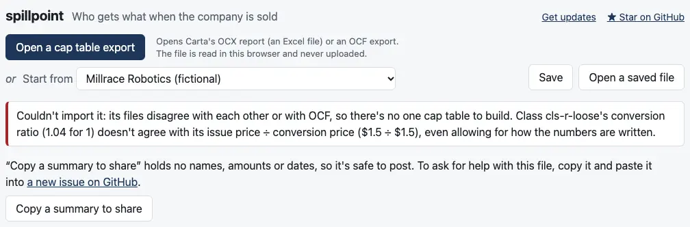
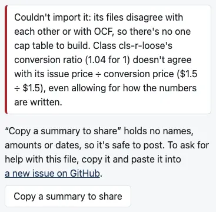
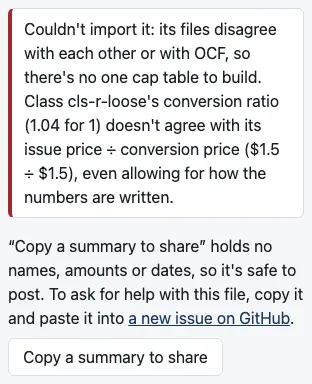
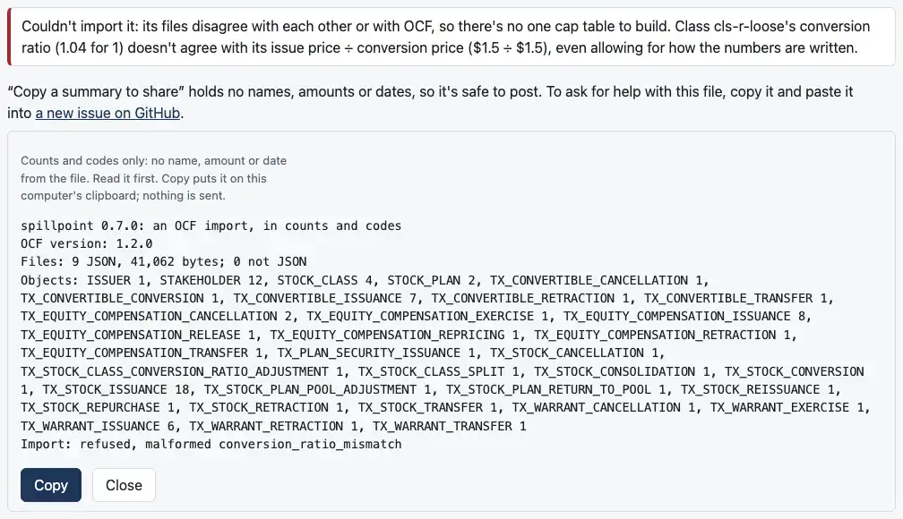
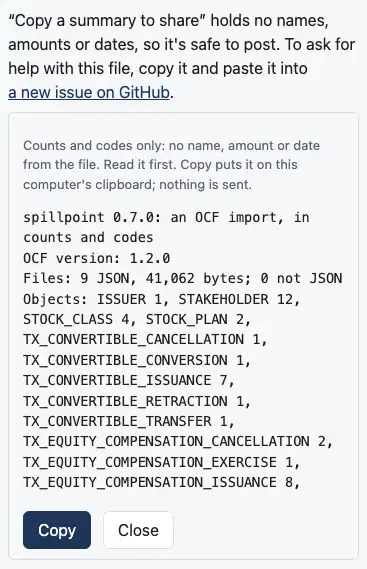
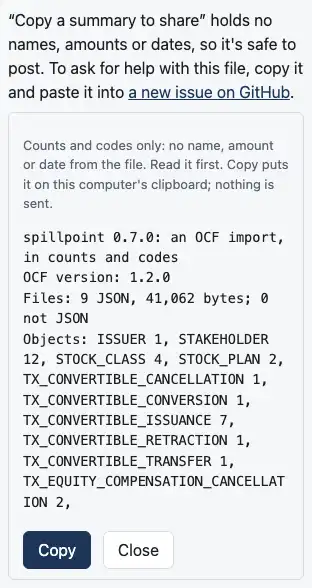

# Review: 10l (a first visit that explains itself)

Branch `10l-first-visit`, from main at `f0ed325` (#144 merged).

**CI and permissions:** no change to `.github/workflows/` or `.claude/`. I added two dashboard entries to my own `.claude/launch.json`, to serve the page while checking it, but git excludes that file, so they're not in this PR.

**Under `.github/`, outside `workflows/`:** the second commit adds `.github/ISSUE_TEMPLATE/export-wont-open.yml`, the issue template you asked for (section 8). It's an issue form, not a workflow: it runs nothing and changes no permission.

**`cases/` and `packages/`:** nothing. No engine change. Outside `apps/dashboard`:
- `apps/site/links.ts` gains the new-issue address.
- `apps/fund/test/site.test.ts` changes because it checks the whole built site's links out (section 4).
- `CLAUDE.md`, `notes/release-1.0.md` and `docs/ASSUMPTIONS.md` (O15) each get a line or two.

## What to look at first

1. **The top of the page,** in the screenshots below: the export is now the first thing under the title, with "or" before "Start from".
2. **How I read "Carta's OCX report, an Excel file".** The line says "Carta's OCX report (an Excel file)", one thing, not two (open question 1).
3. **The line on a refused import,** and its link to a new issue.

## 1. What changed

### Opening an export as a way to start

- **Before:** one row reading "Start from [picker] Save Open [Open a cap table export]", with the export last, after the picker. That's the row your founder read as steps.
- **Now:** under the title, two rows:
  1. "Open a cap table export", drawn as the page's main button (navy, white text), with its line beside it.
  2. "*or* Start from [picker]", and at the right end of the row, Save and "Open a saved file" (since the second commit), set apart as the page's own file.
- **On a phone:** everything stacks at full width: the button, its line, "or" between two rules, "Start from", the picker, then Save and "Open a saved file".
- **Screen readers:** the two ways in are a group named "Start", and the button is described by its line, so the line is read out with the button.
- **Why stacked:** I tried the two side by side first. The picker is as wide as its longest option, which left no room at 1280: the start broke into three ragged rows. Stacked holds at every width.

### The line with it

> Opens Carta's OCX report (an Excel file) or an OCF export. The file is read in this browser and never uploaded.

- **Carta, by its report only** (rule 11): no menus, no site, no path to the export.
- **On a laptop:** a sentence a line, beside the button.
- **On a phone:** under the button, at full width.

### A refused import

> “Copy a summary to share” holds no names, amounts or dates, so it's safe to post. To ask for help with this file, copy it and paste it into [a new issue on GitHub].

- **Where it shows:** just above "Copy a summary to share", in two places:
  - when an import is refused as it's read, under the alert below the masthead
  - when the engine refuses at "Use this cap table", in the review, beside the summary

  It stays above the summary once it's opened.
- **Where it doesn't show** (ASSUMPTIONS O15):
  - on a review nothing has refused yet
  - when a "No" to "One strike?" stops the import: that's the founder's own answer, not a refusal
  - on "Open an OCX workbook on its own", which has no summary to share
- **The link:**
  - goes to a new issue from the template for an export that won't open, `https://github.com/spillpoint/spillpoint/issues/new?template=export-wont-open.yml`, as `ISSUE_URL` in `apps/site/links.ts` (since the second commit; the first went to GitHub's blank form)
  - opens in a new tab, `rel="noopener"` like the star link, so GitHub sees only `https://spillpoint.io/` as where the visit came from
  - has nothing else in its address: the template's name, and no title, body or summary. The founder pastes the summary in.
- **Still sends nothing:** the page's Content-Security-Policy is unchanged, and following a link isn't a request from the page.
- **Why "safe to post" is true:** the summary is O15's counts and codes. For an OCX workbook it adds the structure, which has only the format's own tab names and headers, never a value or a header the company wrote (OX2). An existing test holds this: a refused workbook's summary has none of its holders' names, its series names, or its amounts.

## 2. How to check it by behavior

Run `pnpm --filter @spillpoint/dashboard dev` and open the address it prints.

1. **A first visit, on a laptop:** the navy "Open a cap table export" is right under the title, with its line beside it, and "*or* Start from Millrace Robotics (fictional)" is under that. Click the button without touching "Start from": the file picker opens straight away.
2. **On a phone,** using your browser's device toolbar at 375 and then 320 wide:
   - the same, stacked
   - the page doesn't scroll sideways
   - nothing overlaps
3. **A refused import:**
   1. Click "Open a cap table export" and choose, together, the eight files in `cases/ocf-01-larkspur/package/` and `cases/ocf-03-refused/fixtures/conversion-ratio-loose.ocf.json`.
   2. You should see the alert, "Couldn't import it: its files disagree…", then the line, then the button.
   3. Click "a new issue on GitHub": a new issue opens in a new tab, on the template for an export that won't open. You'll need to be signed in to GitHub. The template only shows once this branch is on main, so before the merge GitHub shows its blank form.
   4. Back on the page, click "Copy a summary to share": the line stays, above the summary.
4. **Refused at Use** is in the tests (section 4). A by-hand check needs an OCX case written out as an .xlsx, which the tests do and the repo doesn't keep.
5. **Optional, the Carta report on your machine:** open the founder's Carta OCX report from `local/`. If it's refused, the line shows under the alert. If it reads, you get the review as before. Either way, nothing leaves your computer.

## 3. Screenshots

These come from the screenshot script's headless Chrome, at 1280, 375 and 320 wide. For each one, the script printed "no sideways scroll at <width> wide": the page is no wider than the screen. I also measured the boxes of everything in the masthead, and of the alert, the line, the button and the summary: none overlap. That's at 375 as the page opens, refused and with the summary open, and at 320 as it opens and refused. At 320 with the summary open, I checked by eye in the shot.

**1280, as the page opens:**

**375 and 320, as the page opens:**

 

**1280, a refused import:**

**375 and 320, a refused import:**

 

**The summary opened, at 1280, 375 and 320:**

 

**Not the Browser pane:** I took the widths' numbers from the script's Chrome. While the app's Browser pane is hidden, its page doesn't render. The chart never learns its width, so it stays at its 960-pixel default and the page seems to scroll sideways at phone widths. Main shows the same thing there. A real browser, and the script's Chrome, don't.

## 4. Tests

- **`apps/dashboard/test/first-visit.test.tsx`** (new, 14 tests with the second commit's):
  - **The start:**
    - The export's button is the first control under the title, in the "Start" group, before "or" and "Start from".
    - It's drawn as the main button.
    - Save and "Open a saved file" sit apart from it, and "Open a saved file" opens only the saved-file picker.
    - Clicking it opens the export picker from the page as it first opens: Millrace still chosen, and nothing asked.
    - An export chosen then opens its review.
  - **The line:**
    - word for word
    - visible, under the button
    - read out with the button, as its description
    - "Carta" once, as "Carta's OCX report", and no address or menu
  - **A refused import:**
    - The help line, word for word, shows for a refused OCX workbook (also with the summary open), for a refused OCF export, and when the engine refuses at Use.
    - It doesn't show on the review before the refusal, on the page as it opens, or on the one-workbook message.
    - Its link: `ISSUE_URL`, new tab, `rel="noopener"`.
    - `ISSUE_URL` is the repository's address plus `/issues/new?template=export-wont-open.yml`, with no other query and no fragment, and the template it names is in `.github/ISSUE_TEMPLATE/`.
    - With the line shown, the page's links out are its usual three plus this one.
  - **The template:** it says first, word for word, that the issue is public and not to attach the export or paste anything from it, and it asks for the summary and the tool, both required, and nothing else.
- **`apps/dashboard/test/privacy.test.ts`:** the built page may name the new issue's address as a third link out, matched exactly, and must. Nothing else changes: still no way to send anything, no browser storage, and the same policy.
- **`apps/fund/test/site.test.ts`:** the same for the whole site:
  - the form and the repository on both pages
  - the new issue on the main page only
  - addresses read whole: the repository's address is the start of the new issue's, so a search for it inside the text would find the new-issue link and count it as the star link
- **Unchanged:** `links.test.tsx` (the page as it opens still has exactly its three links out). The other tests find the export's picker and "Start from" by their labels, which didn't change.

CI's sequence passes locally: install, typecheck, build, the tests and the reference checks.

## 5. The screenshot script

- **Its import helper was broken.** It looked for the export picker by its label before 06g (#88), "Open an OCF export", so every shot that imports (04f, 05b3a, 05b3b, 05c2) had failed since then. The fix is that one selector. I didn't retake those shots.
- **It now prints, for each shot,** whether the page scrolls sideways at the shot's width.
- **The new shots** are `10l-*`.

## 6. Assumptions added

- **O15:** where the line on a refused import shows, and where it doesn't (section 1). It's a page choice, not a modeling one.
- **No modeling choices.**

## 7. Open questions

Questions 1 to 3 are answered (section 8).

1. ~~"Carta's OCX report, an Excel file, or an OCF export": one thing or three?~~ One thing: Carta's OCX report, which is an Excel file. The line stays as it is.
2. ~~Should "Open" say "Open a saved file"?~~ Yes. Done.
3. ~~An issue template?~~ Yes, one. Done.
4. **The root README** doesn't mention the line yet. The release step updates both READMEs.
5. **On a phone, the start takes more room.** At 375 × 812 the payout headline, "At $100M you get $9.75M", now begins near the bottom of the first screen. On a laptop it's still in full view.

## 8. After your review

Your checks passed on `8f8a0dc`. This second commit has your three answers.

1. **The line stays as it was:** "Opens Carta's OCX report (an Excel file) or an OCF export." It was already one thing.
2. **"Open" is now "Open a saved file".** Save is unchanged. Opening a saved file over unsaved changes now asks "Open a saved file? Your unsaved changes to this cap table will be lost." (it said "Open a file?"). At 320 the two buttons still fit on one row (screenshots retaken).
3. **The issue template:** `.github/ISSUE_TEMPLATE/export-wont-open.yml`, "An export that won't open". It's an issue form, so GitHub shows its fields and won't submit without the required ones.
   - **First, in bold:** "This issue is public: anyone can read it." Then: "Don't attach your export, and don't paste anything from it: no names, amounts, dates, tab names or file names."
   - **Where the summary comes from:** "Where the import was refused, click **Copy a summary to share**, read it, then click **Copy**. It holds counts and codes, nothing from your cap table."
   - **"The page's summary":** a box for the pasted summary, required, shown as plain text.
   - **"Which tool made the file?":** one line, required: "The cap table software, and the report or export you chose in it. Not the file's name, which can name the company."
   - **The page's link** now opens it: `…/issues/new?template=export-wont-open.yml`. The address names the template and nothing else, so the page still sends nothing.
   - **It names no tool.** Carta isn't in it, so a founder writes in what made the file.
   - **Not added:** a `config.yml`, so GitHub's chooser still offers a blank issue beside the template. The page's link skips the chooser.

**Checked again:** CI's sequence passes locally. All nine shots were retaken from the new build, with no sideways scroll at 1280, 375 or 320. I parsed the template as YAML and it has the issue form's shape. GitHub shows it only once it's on main, so it can't be seen on GitHub before the merge.
