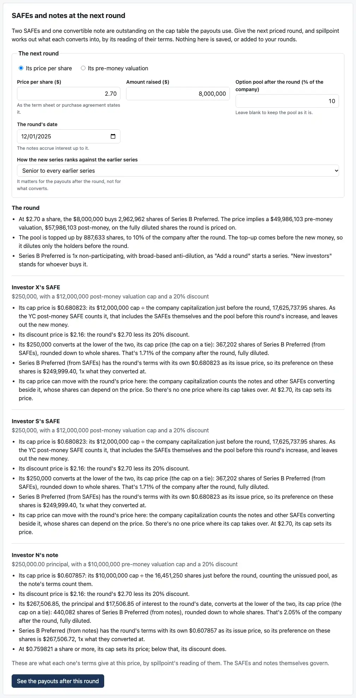
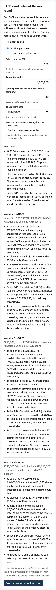
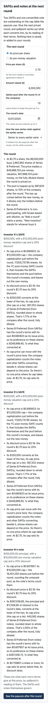
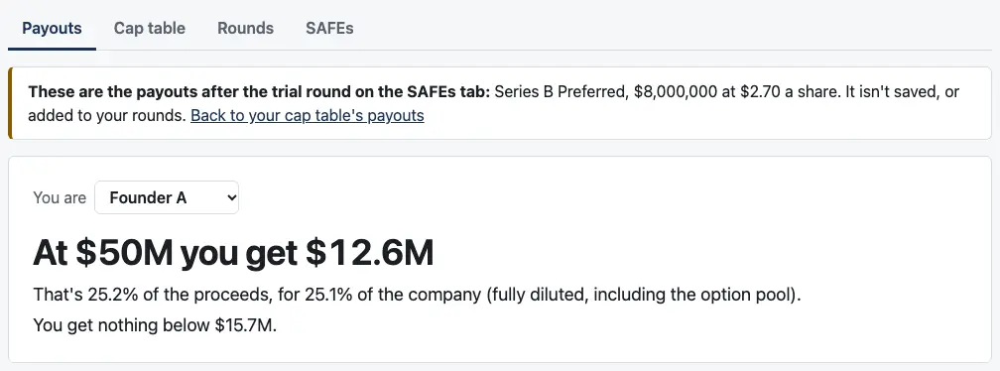
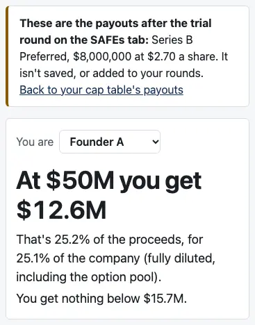

# Review: 11c (the SAFEs tab)

Branch `11c-safes-tab`, from main at `ce267fd` (#148 merged, no PR open). Page only:
- **Nothing in the engine or the cases changed,** and the cases lock is on. Nothing under `packages/`, `cases/` or `reference/` changed.
- **CI and permissions:** no change to `.github/workflows/` or `.claude/`.
- **The screenshot script** (`apps/dashboard/scripts/screenshots.mjs`, a dev tool) gains this step's five shots.

## What changed

1. **`apps/dashboard/src/trial.ts`, new.** The trial round and what it says of each SAFE and note:
   - **`trialBase`:** the table the payouts use, as a start for a round.
   - **`runTrial`:** the round on it, built by the engine.
   - **`conversionRows`:** each conversion's two prices, shares, share after the round, series, preference, and where its cap takes over.
   - **`parsePrice`:** a price as typed.
2. **`apps/dashboard/src/SafesView.tsx`, new:** the SAFEs tab.
3. **`App.tsx`:**
   - the fourth tab
   - the import's date and issue order, and the rounds as last built, passed to the workspace
   - the Payouts tab showing a trial's table, under a line that says so, with a way back
4. **`rounds.ts`:**
   - **`sharePrice` is exported,** the Rounds tab's own price format, so the two tabs write prices alike.
   - **A round's line on the Rounds tab reads its pre-money from the round's details** (`preMoney`, 11b). It's the same text for every round given a pre-money. A round with `price_per_share` in a file written by hand now reads too, with the pre-money its price implies.
5. **`styles.css`:** the tab, the trial's line on the Payouts tab, and the tabs set closer together at 360 wide and under, so four fit at 320.
6. **Tests:**
   - **`test/trial.test.ts`, new:** 72 tests.
   - **`test/safes-tab.test.tsx`, new:** 7 tests.
   - **`test/editor.test.tsx`:** the arrow-key test walks four tabs.
7. **Docs:**
   - **`docs/ASSUMPTIONS.md`:** R33, P3, and R33's general case on the Later list.
   - **`notes/release-1.1.0.md`:** the tab, under "On the page".
   - **`CLAUDE.md`'s "Where things stand":** 11c on main for 1.1.0, and the ledger next.

## What to look at first

1. **Four things the tab needed beyond your list.** Each is in P3.
   - **The round's date,** asked only when a note is outstanding. A note's interest runs to it, and the engine needs it (R23). It starts as the browser's date.
   - **How the new series ranks:** "Alongside {the most senior series} (pari passu)", "Add a round"'s default, or "Senior to every earlier series". It doesn't change what converts, only the payouts after. It's here because case 27's Series B is senior, and without it the trial couldn't give case 27's table.
   - **"New investors",** one holder added for the trial, who buys the new series.
   - **The series' other terms,** as "Add a round" starts them: 1x non-participating, broad-based anti-dilution. A line in the results says so.
2. **The rules are named in words, never by code.** Your item 4 asks for the rule to be named, and the page never shows founders an assumption code: it strips them from the engine's messages. So a SAFE's cap price says "its cap ÷ the company capitalization just before the round … As the YC post-money SAFE counts it, that includes the SAFEs themselves and the pool before this round's increase". It doesn't say "(R4)". If you want the codes shown, it's one line each.
3. **Where the cap takes over (R33).** It's given only where the cap price is the same at any round price:
   - every note, whose base is the share count just before the round
   - a post-money SAFE, when nothing but post-money SAFEs converts beside it
   - a pre-money SAFE, when the round has no pool target

   Elsewhere the tab says the cap price can move with the round's price, and which price applies at the price chosen. Larkspur shows both kinds: its two SAFEs sit beside a note, so they get no crossover, and the note gets one.
4. **The other price is worked out on the page.** The engine gives the price that applies. The one it compared against, it compares and drops. So the page works it out from the round's details by the same rule. A test holds the price that applies to the engine's in all 67 locked priced rounds (below). That's the one piece of money math here that isn't the engine's, and it's held to it. Moving it into the engine, as fields on a SAFE's and a note's conversion, would be an engine step: it's yours to say.
5. **"See the payouts after this round":**
   - **What it shows:** the Payouts tab on the trial's table, with the sale's own terms, its date, carve-out and payment schedules, as the Rounds tab carries them.
   - **What ends it:** "Back to your cap table's payouts", any change to the trial, or any change to the cap table.
   - **The Cap table tab's line** stays the cap table's own meanwhile.
   - **You** are the same holder on the trial's table.
   - **Save** keeps the cap table, never the trial.

## Your tests

1. **Larkspur's import, with a trial at case 27's Series B price, gives case 27's locked table** (`trial.test.ts`).
   - **The setup:** Larkspur's OCF package is read, and its two blanks answered as case 27 fills them. The import's date and issue order are case 27's. A trial on it at case 27's exact price, $8,000,000, 10% and senior, gives case 27's last table.
   - **What's compared:**
     - every position, with "New investors" for Investor Z
     - the pool and the seniority
     - every class and its terms, anti-dilution included, since case 27's Series B is broad-based
     - the price and the post-money
     - the new shares and the top-up
     - each SAFE's and the note's method, shares and series
   - **The same in the page** (`safes-tab.test.tsx`): Larkspur imported as a founder would, the SAFEs tab filled in. It shows 367,202 shares for each SAFE and 440,082 for the note, and $50,000,000 pre-money at $2.700764.
2. **edge-15's crossover price, from the case's own numbers.**
   - **$2.90:** its SAFE's $18,000,000 cap from `inputs.json` ÷ its round's Company Capitalization, 225,000,000/29 shares from `expected.json`, ÷ (1 − 20%). The page's crossover is the same.
   - **At the round's $2.50,** its discount price, $2.00, is below its cap price, $2.32, so the discount applies, as the case has it.
   - **edge-15's Series A as a trial,** by its pre-money and by its exact price, gives its locked table. The one exception is its own series' anti-dilution: edge-15's has none, and "Add a round"'s is broad-based.
3. **The payouts after a trial match `buildCapTables` and `solve`** (`safes-tab.test.tsx`). After "See the payouts after this round", every holder's row on the Payouts tab, at the page's exit value, is that holder's payment as `paid` rounds it. The test works that out from `solve` on the last table `buildCapTables` builds from the trial's events, at the sale's date. Nothing was downloaded, and the way back shows the cap table's own payouts, with no "New investors" in them.
4. **The privacy test passes.** The built page refuses every connection and has no way to make one. The tab adds nothing that could.

**Also tested:**
- **All 67 priced rounds in the locked cases** (`trial.test.ts`). For each SAFE and note it converts:
  - the price the page says applies is the engine's conversion price, within one part in 10^30
  - it's the lower of the two, the cap on a tie
  - where a crossover is given, the round's price is on the side of it the method says
  - its preference is its shares × its price × its multiple
- **A company built from rounds:** Millrace, its payouts on the table before its Seed (event 5). A trial at the Seed's own price converts Priya's and Marcus's SAFEs into 779,362 and 389,681 shares, Millrace's locked counts.
- **A cap table entered directly:** edge-12b's, its SAFE with a $10,000,000 post-money cap and a 20% discount.
  - At $1.00: its cap price is $0.857143 (6/7), its discount price is $0.80, and the discount applies.
  - At $2.00, the cap applies.
  - Its cap takes over at $1.071429.
- **Plain asks:** what's missing is asked for in plain words, and a price that isn't one says so.
- **No judgment words:** the tab's text has none of "good", "bad", "should", "recommend", "deal", "fair", "favorable" or "advice".
- **The tabs:** four, the SAFEs tab last, reached by End.

## How to check it by behavior

1. **Run what CI runs:**

   ```bash
   pnpm install && pnpm typecheck && pnpm build && pnpm test && pnpm test:reference
   ```

   I got:
   - 3,938 engine tests
   - 792 page tests, 79 more than 11b's 713
   - 2,115 fund tests, 13 skipped
   - 838 fund page tests
   - the reference's 79 unit tests, and all 86 exit and round cases matching it
2. **On the page, a company built from rounds.** Start from Millrace. On the Rounds tab, set "The payouts use the cap table after" to "5. Options granted". Then open the SAFEs tab:
   - It says two SAFEs are outstanding.
   - Type a price of `0.46`, $2,500,000, and 18%. Each SAFE converts at its cap price, $0.384930.
   - Type `0.38` as the price: each now converts at the round's own price, as its last line says it does below $0.384930.
3. **On the page, an import.** Open Larkspur's package, `cases/ocf-01-larkspur/package`, with "Open a cap table export":
   - Answer Seed Preferred: non-participating, Investor N's note: 1, and any sale date. Then "Use this cap table".
   - On the SAFEs tab, type `2.70`, `8,000,000`, `10`, the date `2025-12-01`, and "Senior to every earlier series". The screenshots below are that.
   - Then "See the payouts after this round", and the way back.
4. **A cap table entered directly:** choose "A blank cap table", add a SAFE on the Cap table tab, and the SAFEs tab has it.
5. **Phones:** at 375 and 320 wide, nothing scrolls sideways. The screenshot script checks each shot and reported no sideways scroll at 1280, 375 or 320. Before the tab fix, 320 scrolled 20px sideways: the fourth tab ran past the edge.

## Screenshots

The SAFEs tab on Larkspur's import, with case 27's Series B at $2.70 a share, as a term sheet would round it. At $2.70 the price implies a $49,986,103 pre-money, where case 27's $2.700764 gives $50,000,000. Both SAFEs and the note convert at their cap prices.

At 1280:



At 375 and 320:

 

"See the payouts after this round", at 1280 and 375:





## Assumptions added

- **R33, new:** each SAFE's and note's two prices, and where its cap takes over, only where that's exact.
- **P3, new:** the trial round:
  - what it starts from
  - "Add a round"'s terms
  - the date and the ranking
  - "New investors"
  - what each SAFE's lines say, and in what words
  - the payouts after it, never saved
- **The Later list:** where a SAFE's cap takes over when its cap price moves with the price.

## Decisions for you to check

1. **The four additions** (look-first 1): the date, the ranking, "New investors", and "Add a round"'s series terms.
2. **The rules named in words, not codes** (look-first 2).
3. **The other price on the page, held to the engine's** (look-first 4). Or an engine step to give both prices.
4. **The price field takes a fraction,** `9276475000/3434759253`, as the engine reads one. That's how the tests reach case 27's exact table. A founder types a decimal, and the hint says "As the term sheet or purchase agreement states it."

## Next

The ledger: 11d, its rules and Quillfern, which lifts the cases lock. I'm stopping here.
