# Review: 11c2 (one way to model the next round)

Branch `11c2-one-way-to-model-a-round`, from main at `b43b7f2` (#149 merged, no PR open). Page only:
- **Nothing in the engine or the cases changed,** and the cases lock is on. Nothing under `packages/`, `cases/` or `reference/` changed.
- **CI and permissions:** no change to `.github/workflows/` or `.claude/`.
- **The screenshot script** (`apps/dashboard/scripts/screenshots.mjs`, a dev tool): 11c's five shots, which needed the SAFEs tab, are replaced by this step's eleven. 11c's images stay in `notes/screenshots/` for `review-11c.md`.

## What changed

1. **"Add a round" takes the round by its price per share or its pre-money** (`RoundsEditor.tsx`, `roundsDraft.ts`, `blankNames.ts`):
   - **The choice:** a new field on every priced round, "The round is given by": "Its pre-money valuation" or "Its price per share".
   - **Switching** starts the other field blank, since one isn't the other in different units.
   - **How a price is read:** a price is typed as amounts are ("$2.70" is 2.7) or as an exact fraction, and saved as given.
   - **Left blank,** it's named: "Series B Preferred's price per share can't be blank."
   - **What the round's first line says:** a round given its price says the pre-money the price implies: "$8,000,000 at $2.70 a share. The price implies a $49,986,103 pre-money valuation, $57,986,103 post-money, on the fully diluted shares the round is priced on."
2. **Each round's summary explains every SAFE and note it converts** (`conversions.ts`, new, from 11c's `trial.ts`; `rounds.ts`). Under the line that says what each converts into:
   - its cap price, and what the cap divides by, by the rule its kind follows
   - its discount price
   - that it converts at the lower of the two, the cap price on a tie
   - for a note, its interest: its rate, simple, from its issue date to the round's date, each day 1/365 of a year
   - its shares, rounded down, and its share of the company after the round, fully diluted
   - the series it converts into, with its own issue price, and that series' preference on its shares
   - where its cap takes over, where R33 makes that exact, or else why there's no one price, and which price sets it at the round's

   That's every priced round's summary, a company's own rounds and one being modeled alike.
3. **A cap table entered directly or imported:**
   - **The Rounds tab** says plainly that a round added there shows what its SAFEs and notes convert into, and that removing it takes the cap table back. It says whether the table was imported or entered directly.
   - **Removing the round takes it back:** taking out the last event after a starting table goes back to that table, with no rounds (look-first 1).
   - **The Payouts tab** gets one line while SAFEs or notes are outstanding: "Two SAFEs and a convertible note are outstanding on this cap table. To see what they would convert into at the next round, add one on the Rounds tab." The link goes to the Rounds tab's "Add a round".
   - **The Cap table tab's "The next round" card** says the same about removing.
4. **The SAFEs tab, its trial and its banner are gone:**
   - `SafesView.tsx`, `trial.ts` and `safes-tab.test.tsx` deleted
   - `App.tsx` back to 11b's, plus `backToTable`, the Payouts line and the Rounds tab's props
   - `styles.css` back to 11b's, plus one rule for the Payouts line. Three tabs fit at 320 again, so 11c's closer tab spacing went with the fourth tab.
   - `editor.test.tsx`'s tabs test back to three
5. **`format.ts`:** `sharePrice` and `dateText` moved there from `rounds.ts`, which re-exports `dateText`. That way `conversions.ts` uses them without importing `rounds.ts`, which imports it.
6. **Tests:**
   - **`test/conversions.test.ts`:** 11c's `trial.test.ts`, carried over to the Rounds path. 113 tests.
   - **`test/round-conversions.test.tsx`, new:** 7 tests.
   - **`test/add-a-round.test.tsx`:** case 27 by its price per share, saved and opened again.
   - **`rounds.test.tsx` and `acceptance.test.tsx`:** the new lines under Millrace's Seed SAFEs and under a note.
7. **Docs:**
   - **`docs/ASSUMPTIONS.md`:**
     - P3 rewritten, from the trial round to the round on the Rounds tab
     - R33 and its Later item say "the round's summary" in place of "the tab"
   - **`notes/plan-2.0.md`:**
     - a note at the top saying what 11c2 changed
     - sections 1 to 3, the steps (11c2 added) and the release notes, in place of the SAFEs tab
     - 11l without "Add it to the ledger", or its test
     - the answers at the end left as given
   - **`notes/release-1.1.0.md`:** "On the page" says this in place of the SAFEs tab, which was never released.
   - **`CLAUDE.md`'s "Where things stand":** one line in place of the SAFEs tab's.

## What to look at first

1. **Removing the round takes the cap table back: new behavior, so the sentence is true.** Before, removing the round left the company's rounds with only their starting table:
   - the same payouts
   - but still "built from its 1 event"
   - no "Add a round"

   Now, when the event removed is the last one after a starting table, the cap table goes back to that table, with no rounds, as before "Add a round":
   - **What it keeps:** its edits on the Cap table tab, the sale's terms and the range as typed, an import's date and issue order, and the same holder as you.
   - **What goes:** the holders added for the rounds.
   - **The question first:** "Remove event 2, Series B Preferred, a priced round? What it did goes, and you're back to the cap table the round started from, with no rounds."

   Removing any other event is as before.
2. **The pre-money stays the default.** It's what a term sheet states, and every round today is given that way, so files and tests are unchanged. The trial started on the price. One line to change if you'd rather.
3. **The lines are shown open, under every conversion, in every round:**
   - **How many:** six under each SAFE, seven under a note. Larkspur's Series B grows to a screen and a half (screenshot below), and Millrace's Seed by twelve lines.
   - **The other way:** a "How it converts" disclosure under each conversion's line, closed until opened. It's one change.
4. **The Payouts tab's line is only on a cap table with no rounds.** Your item 3 is about those. A company built from rounds already says, on the event that creates each SAFE or note, whether it's outstanding at the sale. On such a company the line would also have to say which round to add, and where, so it says nothing there.
5. **A round modeled this way is saved with the rounds.** It's a round now, not a trial, and it's recorded where it's modeled, as the plan now has it. The ways out are removing it, which takes the cap table back, or "Edit the cap table directly".

## Your tests

1. **Larkspur's import with case 27's Series B added as a round gives case 27's table.** It's checked three ways:
   - **Built** (`conversions.test.ts`): "Add a round" on Larkspur's import, its blanks answered as case 27's, with Investor Z added and the round given by case 27's exact price, $8,000,000, 10% and senior. That gives case 27's last table:
     - every position, and the pool and the seniority
     - every class and its terms, anti-dilution included
     - the price and the post-money, the new shares and the top-up
     - each SAFE's and the note's method, shares and series

     Its first line says the $50,000,000 pre-money the price implies.
   - **Clicked through, to the cent** (`add-a-round.test.tsx`): the same round typed into the page:
     - It's saved with `price_per_share` exactly as typed, and no pre-money.
     - It pays as case 27 does at every breakpoint, to the cent.
     - Opened again, it's still given by its price, and pays the same.
   - **Its summary** (`round-conversions.test.tsx`): each SAFE's 367,202 shares and the note's 440,082. The note's $0.607857 cap price is its $10,000,000 cap ÷ 16,451,250 shares, with its interest to Dec 1, 2025. The SAFEs' cap price can move with the price, since the note converts beside them; the note's cap takes over at a price of its own.
2. **edge-15's crossover** (`conversions.test.ts`):
   - **$2.90 from the case's own files:** its $18,000,000 cap from `inputs.json` ÷ 225,000,000/29 shares from `expected.json` ÷ (1 − 20%). The page's crossover is the same.
   - **The summary:** edge-15's round's summary says it under the SAFE: "At $2.90 a share or more, its cap sets its price; below that, its discount does." It also gives the discount price, $2.00, below the cap price, $2.32, so the discount applies, as the case has it.
   - **By its price:** edge-15's Series A given by its exact price per share, as the round's form writes it, gives its locked table, its own terms included.
3. **The 67-round check of the price that applies** (`conversions.test.ts`). In every priced round in the locked cases, for each SAFE and note it converts:
   - the price the page says applies is the engine's, within one part in 10^30
   - it's the lower of the two, the cap on a tie
   - where a crossover is given, the round's price is on the side of it the method says
   - its preference is its shares × its price × its multiple

   New with it: every round's summary in every locked round case explains every SAFE and note it converts, and none has a word of judgment.
4. **The privacy test passes.** Nothing new reaches the network or a URL.

**Also tested** (`round-conversions.test.tsx`):
- **The way there:** the Payouts tab's line on Larkspur's import, its link to the Rounds tab, and the Rounds tab's words.
- **Removing the round:** the import comes back with no rounds and the same payouts, and "Add a round" again starts from the same table, dated as before.
- **A cap table entered directly,** edge-12b's, at $1.00:
  - its SAFE's cap price, $0.857143, from 11,666,666.67 shares
  - its discount price, $0.80, which applies
  - its cap taking over at $1.071429
  - at $2.00, its cap price
- **A blank price per share,** named. Switching back to the pre-money starts that blank and keeps the amount.
- **Millrace:** no Payouts line, and three tabs.

## How to check it by behavior

1. **Run what CI runs:**

   ```bash
   pnpm install && pnpm typecheck && pnpm build && pnpm test && pnpm test:reference
   ```

   I got:
   - 3,938 engine tests
   - 834 page tests, 42 more than 11c's 792: `conversions.test.ts`'s 113 in place of `trial.test.ts`'s 72, `round-conversions.test.tsx`'s 7 in place of `safes-tab.test.tsx`'s 7, and one more in `add-a-round.test.tsx`
   - 2,115 fund tests, 13 skipped
   - 838 fund page tests
   - the reference's 79 unit tests, and all 86 exit and round cases matching it
   - the fund reference's 125 unit tests, and its 41 cases
2. **An import.** Open Larkspur's package, `cases/ocf-01-larkspur/package`, with "Open a cap table export". Answer Seed Preferred: non-participating, Investor N's note: 1, and any sale date, then "Use this cap table".
   - The Payouts tab's first line says two SAFEs and a convertible note are outstanding. Click "Rounds tab".
   - The Rounds tab says what adding a round does, and that removing it takes it back. Click "Add a round".
   - Add a holder, Investor Z. In the round, set the date to Dec 1, 2025 and "The round is given by" to "Its price per share". Type `2.70`, the pool `10`, Investor Z's `8,000,000`, and "Senior to every earlier series". Click "Done". The screenshots below are that.
   - Open it again and "Remove this event": the cap table is the import's again, with its Payouts line.
3. **A company built from rounds.** On Millrace's Rounds tab, event 6, the Seed, now explains each SAFE under its line: its $0.384930 cap price, and its cap taking over at $0.384930.
4. **A cap table entered directly:** choose "A blank cap table", and on the Cap table tab add a SAFE of `500000` with a `10000000` cap.
   - **The Payouts tab:** "A SAFE is outstanding on this cap table…", with its link.
   - **The Rounds tab:** add a round at a `20M` pre-money with `5000000` from the founder. The SAFE converts at its $0.95 cap price, its $10,000,000 cap ÷ 10,526,315.79 shares, below the round's $1.90. I checked this in the browser pane.
5. **Phones:** at 375 and 320 wide nothing scrolls sideways. The screenshot script checks each shot, and reported no sideways scroll for any of the eleven.

## Screenshots

Larkspur's import with case 27's Series B added on the Rounds tab, by its price per share, $2.70, as a term sheet would round it. Each SAFE and the note converts at its cap price.

The round's summary at 1280:

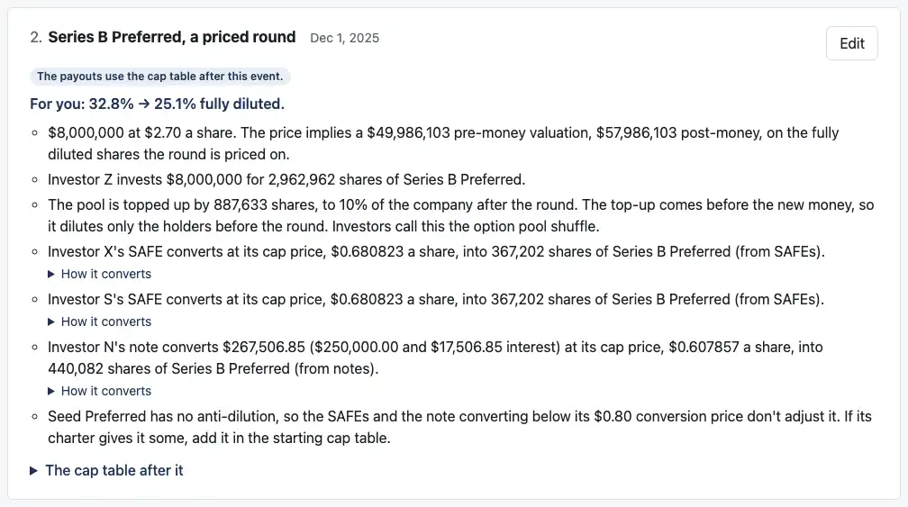

At 375 and 320 (long: the whole round):

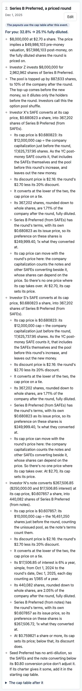 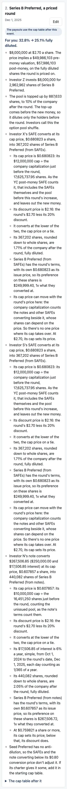

The round given by its price per share, at 1280 and 320:

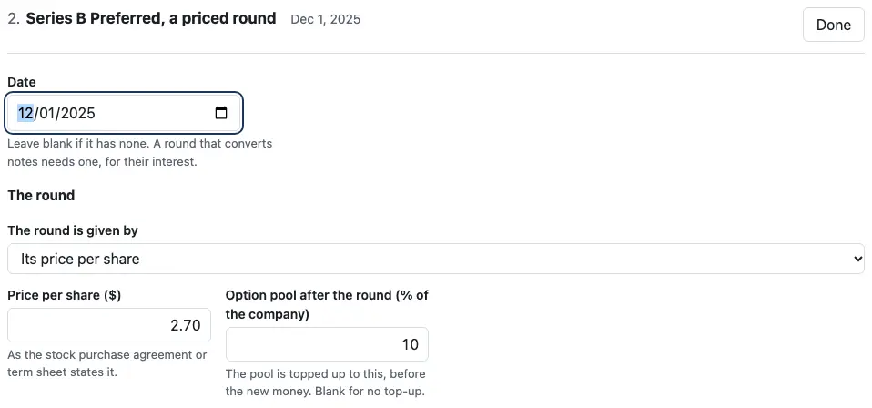

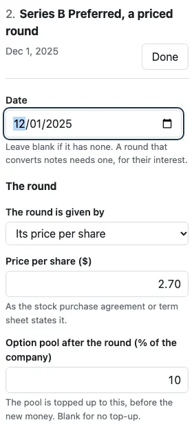

The Rounds tab on the import, before a round, at 1280, 375 and 320:

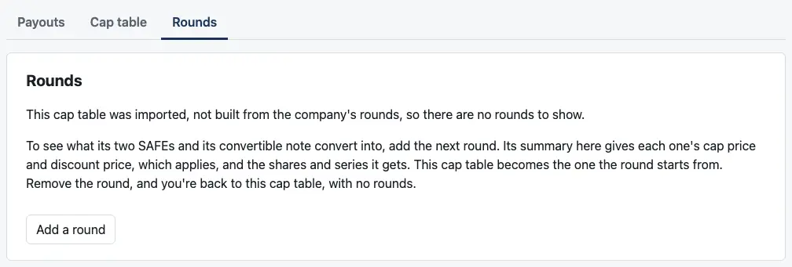

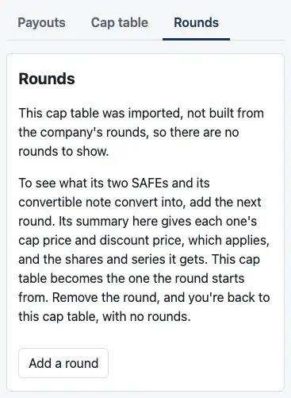 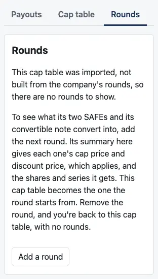

The Payouts tab's line, at 1280, 375 and 320:

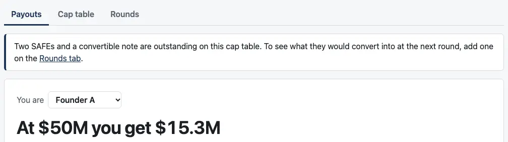

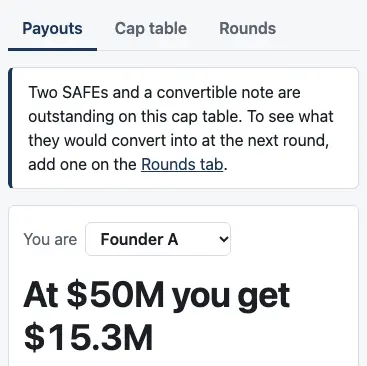 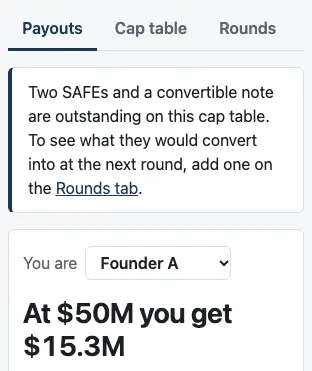

## Assumptions added

- **P3, rewritten:** one way to model the next round, on the Rounds tab:
  - where it is, and what the Rounds and Payouts tabs say
  - the round as "Add a round" starts it
  - given by its pre-money, the default, or its price per share
  - what its summary says of each SAFE and note
  - removing the last round
  - saving
  - what 11c2 took out
- **R33:** "the round's summary" in place of "the tab", in its row and its Later item.

## Decisions for you to check

1. **Removing the last round takes the cap table back** (look-first 1).
2. **The pre-money stays the default** (look-first 2).
3. **The lines shown open** (look-first 3), or under a disclosure.
4. **The Payouts tab's line only on a table with no rounds** (look-first 4).

## Open question

**The plan's chart, not built in 11c or here.** Section 3 of the plan has "a chart of each holder's percentage after the round against the round's price, drawn from exact points", marking where each cap takes over. Should it be a step of its own, or come off the plan?

## Next

The ledger: 11d, its rules and Quillfern, which lifts the cases lock. I'm stopping here.
